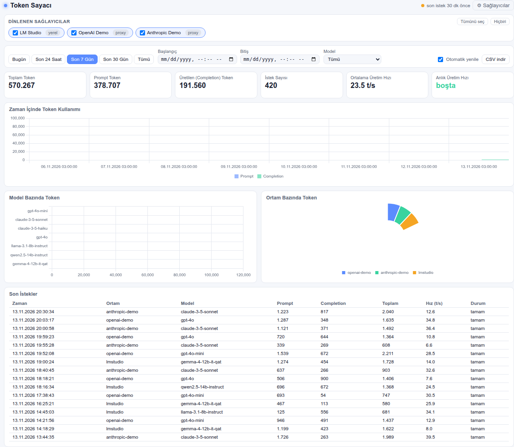
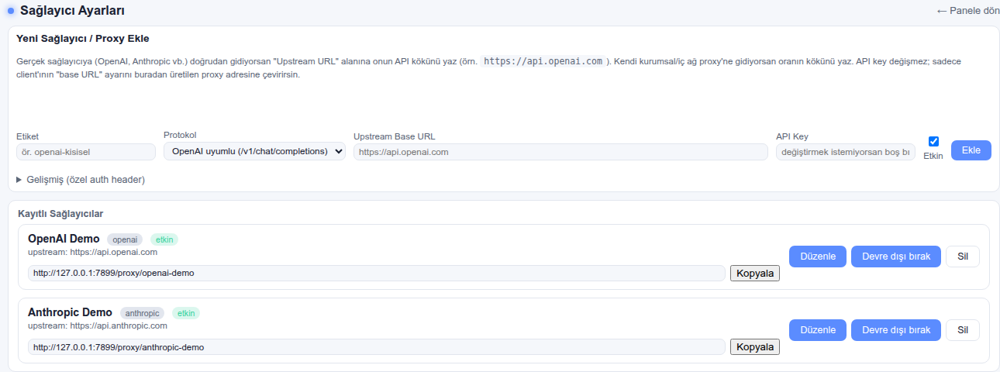

# Token Sayacı (Token Counter)

A self-hosted, zero-dependency dashboard that tracks token usage across **local** LLM runtimes (LM Studio, with a pluggable parser architecture for others) and **any external LLM provider** (OpenAI, Anthropic, or your own internal/corporate proxy), in real time.



> Screenshot above uses synthetic demo data generated for documentation purposes.

## Why

Most "LLM usage" dashboards only work if you're calling a provider's billing API. This project instead:

- **Passively tails LM Studio's own log files** — no code changes, no extra config, nothing to break.
- **Transparently proxies external providers** — point your client's base URL at this app instead of the real provider, and every request's token usage is captured and forwarded unchanged.

Both paths write to the same event store, so one dashboard shows everything: what you're spending locally and what you're spending on remote APIs — whether you call them directly or through your own internal gateway.

## Features

- **Per-environment & per-model breakdown** — prompt tokens, completion tokens, totals, request counts.
- **Live token/sec gauge** via Server-Sent Events, plus average generation speed.
- **Date/time filtering** (today, 24h, 7d, 30d, all-time, or a custom range).
- **Multi-select environment filter** — checkboxes to choose exactly which sources (LM Studio + any configured providers) feed the stats, charts and table.
- **Charts** (Chart.js): token usage over time, tokens by model, tokens by environment.
- **Recent-requests table** with CSV export.
- **Settings page** to add/edit/disable/delete external providers (OpenAI-compatible or Anthropic-compatible), each exposed as its own local proxy URL.
- **Zero external dependencies** — pure Node.js `http`/`https`, JSONL storage with monthly rotation, no database.
- **Runs continuously in the background**, auto-starting on boot via a systemd user service.
- **Optional port-80 access** via a local DNS hostname (e.g. `http://tokendashboard`) with no port in the URL.

## How it works

### Local usage (LM Studio)

The collector polls LM Studio's `server-logs/YYYY-MM/*.log` files (under `~/.lmstudio` by default, or `$LMSTUDIO_HOME`), parses request/response timing lines, and records one event per completed request — prompt tokens, completion tokens, timing, and tokens/sec. Byte offsets are persisted so restarts don't reprocess old lines.

### External providers (direct or via your own proxy)

Add a provider in the Settings page:

| Field | Meaning |
|---|---|
| Label | Friendly name, also used to generate the provider's id/URL slug |
| Protocol | `openai` (OpenAI-compatible `/v1/chat/completions`) or `anthropic` (`/v1/messages`) |
| Upstream Base URL | The real endpoint to forward to — a cloud provider (`https://api.openai.com`) **or** your own internal/corporate proxy |
| API Key | Stored locally (file permissions `600`), injected into the forwarded request's auth header |

This generates a local proxy URL like `http://127.0.0.1:7879/proxy/<provider-id>/`. Point your client's "base URL" at that instead of the real endpoint — everything else (model, messages, streaming) passes through unchanged. The app:

- Parses `usage` from both streaming (SSE) and non-streaming JSON responses.
- For OpenAI-compatible streams, injects `stream_options.include_usage` so a final usage-bearing chunk is always sent.
- For Anthropic-compatible streams, reads `input_tokens`/`output_tokens` from `message_start`/`message_delta` events.
- Approximates live tokens/sec during streaming (exact totals are always recorded once the response completes).

Because it's a generic reverse proxy keyed only on protocol (not on a specific vendor), it works identically whether "upstream" is a real provider or your own internal gateway.

## Screenshots

| Dashboard | Provider settings |
|---|---|
|  |  |

## Getting started

Requires Node.js 18+. No `npm install` needed — there are no dependencies.

```bash
git clone https://github.com/tekinaltun2025/TokenCounter.git
cd TokenCounter
node src/server.js
# -> http://127.0.0.1:7879
```

Environment variables:

| Variable | Default | Purpose |
|---|---|---|
| `PORT` | `7879` | HTTP port |
| `HOST` | `127.0.0.1` | Bind address |
| `LMSTUDIO_HOME` | `~/.lmstudio` | Where to look for LM Studio's log files |

Data is stored under `data/` (JSONL event files, provider config, tail offsets) — this directory is git-ignored.

## Running continuously (autostart on boot)

A ready-made user systemd unit is included:

```bash
./scripts/install-service.sh
```

This installs and enables `local-llm-token-sayaci.service` under `systemctl --user`, so the dashboard restarts on failure and (with [`loginctl enable-linger`](https://www.freedesktop.org/software/systemd/man/loginctl.html)) starts on boot even before login.

```bash
systemctl --user status local-llm-token-sayaci
journalctl --user -u local-llm-token-sayaci -f
```

### Optional: a port-less local URL

To reach the dashboard at `http://tokendashboard` (no `:7879`) instead of an IP:port:

1. Add a hosts entry: `127.0.0.1 tokendashboard`
2. Redirect local port 80 → 7879 with the included iptables unit:
   ```bash
   sudo cp systemd/tokendashboard-redirect.service /etc/systemd/system/
   sudo systemctl daemon-reload
   sudo systemctl enable --now tokendashboard-redirect.service
   ```

## API

| Endpoint | Description |
|---|---|
| `GET /api/environments` | Known sources (LM Studio + configured providers) for the checkbox filter |
| `GET /api/summary` | Aggregated totals, per-model/per-environment breakdowns, timeseries buckets |
| `GET /api/events` | Recent request list |
| `GET /api/events.csv` | CSV export |
| `GET /api/live` | Server-Sent Events stream of live tokens/sec |
| `GET /api/models` | Known model names (for the filter dropdown) |
| `GET /api/health` | Last-event freshness check |
| `GET/POST/PUT/PATCH/DELETE /api/providers` | Provider CRUD (API keys never returned, only `hasApiKey`) |
| `ANY /proxy/:providerId/*` | The reverse proxy endpoint for a configured provider |

All endpoints accept `from`, `to` (epoch ms), `environment` (comma-separated ids; omit for all, empty value for none) and `model` as query filters where applicable.

## Project layout

```
src/
  server.js          HTTP server, routing
  store.js            JSONL event store + query filters
  collector.js         Polls & tails LM Studio logs
  parsers/lmstudio.js  LM Studio log line parser
  providers.js         Provider (external LLM) config store
  proxyGateway.js       Generic OpenAI/Anthropic-compatible reverse proxy
  liveBus.js            Pub/sub for live token-rate ticks
  aggregate.js          Summary & timeseries bucketing
public/               Static dashboard frontend (vanilla JS, Chart.js)
systemd/              User + system service units
scripts/              Install helpers
```

## License

MIT
